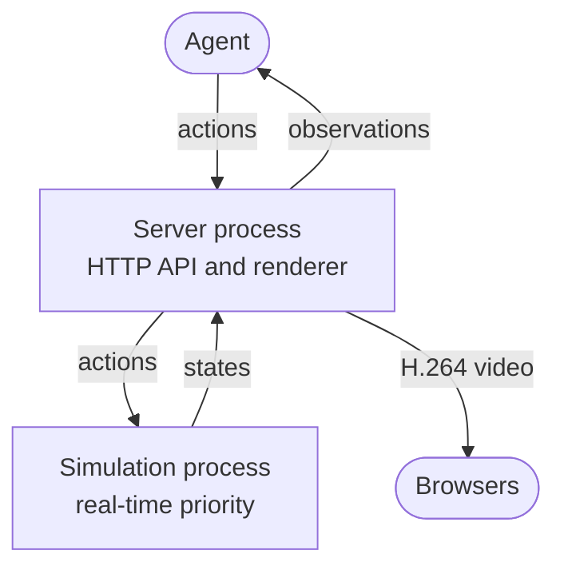

# robogym

robogym lets AI agents control simulated robots over HTTP. The simulation runs in real time, like a real robot: it keeps going while the agent decides what to do next. You can watch it live in a browser.

## Quick start

```bash
git clone https://github.com/torayeff/robogym.git
cd robogym
uv run robogym serve so101_dual_arm --host 127.0.0.1 --port 8000
```

Open http://127.0.0.1:8000 to watch. The simulation starts paused. From another terminal, start it, move an arm and read an observation:

```bash
curl -X POST localhost:8000/resume
curl --json '{"joints": {"left_shoulder_lift": -0.75}}' localhost:8000/action
curl localhost:8000/observation
```

Interactive API documentation is at http://127.0.0.1:8000/docs.

On Linux without a display, set `MUJOCO_GL=egl` so that MuJoCo can render offscreen. On macOS, a warning at startup that `AVFFrameReceiver` is implemented twice is harmless.

## Environments

- [so101_dual_arm](robogym/envs/so101_dual_arm/README.md): two SO-101 arms at a table with a block and a tray, simulated in MuJoCo.

Each environment's README describes its robot, its observations and its actions.

## API

| Method | Path | Description |
| --- | --- | --- |
| GET | `/spec` | A description of the environment, with JSON Schemas for its observations and actions |
| GET | `/observation` | The current observation, with every reading taken at the same instant |
| POST | `/action` | Send an action, which takes effect at the next simulation step |
| POST | `/pause` | Pause the simulation |
| POST | `/resume` | Resume the simulation |
| POST | `/reset` | Reset the scene and the clock, and pause |
| GET | `/status` | Whether the simulation is running, its time, and how many steps ran late |

An action that doesn't match the spec is rejected with status 422 and a message saying what is wrong. The server has no authentication, so anyone who can reach it can control the simulation.

## Running in the cloud

robogym can serve an environment from a [Modal](https://modal.com) sandbox at a public HTTPS URL, so that agents and viewers can reach it from anywhere.

1. Create a [Modal token](https://modal.com/settings/tokens).
2. Copy [.env.example](.env.example) to `.env` and fill in the token's ID and secret.
3. Start a sandbox:

   ```bash
   uv run robogym sandbox create so101_dual_arm
   ```

The command prints the sandbox's ID and URL. `uv run robogym sandbox list` shows the running sandboxes, and `uv run robogym sandbox delete <id>` stops one. A sandbox also stops by itself after 30 minutes without connections, or after two hours.

Browsers play the video only on pages served over HTTPS or from localhost. To watch a server on another machine without a sandbox, put it behind an HTTPS proxy.

## How it works



A real-time simulation has to keep pace with the clock even while the server is busy answering requests and rendering images. So robogym runs the simulation in a process of its own and asks the operating system for real-time priority. On Linux, grant it with the `CAP_SYS_NICE` capability (`--cap-add=SYS_NICE` in Docker). Without it, the simulation runs at normal priority and can fall behind on a busy machine; `/status` counts the steps that ran late.

The server process answers requests and does all the rendering. For an observation, it takes a snapshot of the simulation state and renders the camera images from it while the simulation keeps running, so every reading in an observation comes from the same instant. Actions go the other way: the server checks each one against the spec and passes it on, and the simulation applies it at its next step. If the simulation breaks down, for example when the physics diverges, it resets and pauses itself.

For the browser view, the server renders the scene up to 30 times a second, encodes it once as H.264, and streams the same video to every viewer.

## Adding an environment

The server talks to an environment only through the `Env` interface in [robogym/env.py](robogym/env.py), whose methods match the API. That works for two kinds of simulator:

- A simulator that Python can step, such as MuJoCo, implements `Physics`, and a `PhysicsProcess` ([robogym/physics.py](robogym/physics.py)) runs it in real time.
- A simulator that runs and renders in its own process, such as Isaac Sim, can run separately, with its `Env` acting as a client to it.

To add one:

1. Create a package in `robogym/envs/` with an `Env` subclass, and register it in `ENVS` in [robogym/envs/\_\_init\_\_.py](robogym/envs/__init__.py) as `"<name>": "robogym.envs.<name>.env:<Class>"`.
2. If it uses `PhysicsProcess`, keep the `Physics` methods fast, since they run between simulation steps, and make the state it returns hold everything needed to render the scene. Keep rendering libraries out of the module that defines it, because the simulation process imports that module.
3. To run it in a cloud sandbox, add a `Dockerfile`, built from the repository root with `robogym` on its `PATH`, and a `sandbox.toml` with `vcpus`, `memory_gib` and, if it needs one, a Modal `gpu` type. A sandbox with a GPU runs under gVisor, which doesn't allow real-time priority; a sandbox without one runs in a VM, which does.
4. Run `uv run pytest`. [tests/test_envs.py](tests/test_envs.py) checks every registered environment against the `Env` interface.

[so101_dual_arm](robogym/envs/so101_dual_arm/) is a complete example.
