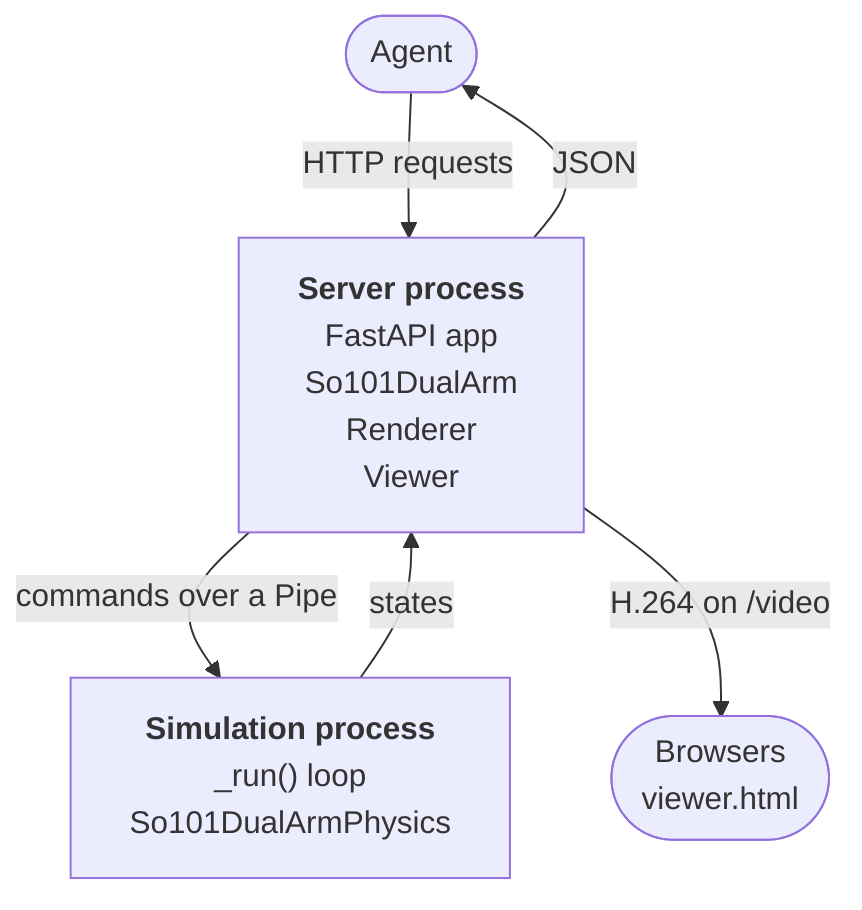

# robogym

robogym lets AI agents control simulated robots over HTTP. The simulation runs in real time, like a real robot: it keeps going while the agent decides what to do next. You can watch it live in a browser.

## Quick start

```bash
git clone https://github.com/torayeff/robogym.git
cd robogym
uv run robogym serve so101_dual_arm --host 127.0.0.1 --port 8000
```

Open http://127.0.0.1:8000 to watch. The simulation starts paused. From another terminal, start it, move an arm and read an observation:

```bash
curl -X POST localhost:8000/resume
curl --json '{"joints": {"left_shoulder_lift": -0.75}}' localhost:8000/action
curl localhost:8000/observation
```

Interactive API documentation is at http://127.0.0.1:8000/docs.

On Linux without a display, set `MUJOCO_GL=egl` so that MuJoCo can render offscreen. On macOS, a warning at startup that `AVFFrameReceiver` is implemented twice is harmless.

## Environments

- [so101_dual_arm](robogym/envs/so101_dual_arm/README.md): two SO-101 arms at a table with a block and a tray, simulated in MuJoCo.

Each environment's README describes its robot, its observations and its actions.

## API

| Method | Path | Description |
| --- | --- | --- |
| GET | `/spec` | A description of the environment, with JSON Schemas for its observations and actions |
| GET | `/observation` | The current observation, with every reading taken at the same instant |
| POST | `/action` | Send an action, which takes effect at the next simulation step |
| POST | `/pause` | Pause the simulation |
| POST | `/resume` | Resume the simulation |
| POST | `/reset` | Reset the scene and the clock, and pause |
| GET | `/status` | Whether the simulation is running, its time, and how many steps ran late |

An action that doesn't match the spec is rejected with status 422 and a message saying what is wrong. The server has no authentication, so anyone who can reach it can control the simulation.

## Running in the cloud

robogym can serve an environment from a [Modal](https://modal.com) sandbox at a public HTTPS URL, so that agents and viewers can reach it from anywhere.

1. Create a [Modal token](https://modal.com/settings/tokens).
2. Copy [.env.example](.env.example) to `.env` and fill in the token's ID and secret.
3. Start a sandbox:

   ```bash
   uv run robogym sandbox create so101_dual_arm
   ```

The command prints the sandbox's ID and URL. `uv run robogym sandbox list` shows the running sandboxes, and `uv run robogym sandbox delete <id>` stops one. A sandbox also stops by itself after 30 minutes without connections, or after two hours.

Browsers play the video only on pages served over HTTPS or from localhost. To watch a server on another machine without a sandbox, put it behind an HTTPS proxy.

## Adding an environment

The server talks to an environment only through the `Env` interface in [robogym/env.py](robogym/env.py), whose methods match the API. That works for two kinds of simulator:

- A simulator that Python can step, such as MuJoCo, implements `Physics`, and a `PhysicsProcess` ([robogym/physics.py](robogym/physics.py)) runs it in real time.
- A simulator that runs and renders in its own process, such as Isaac Sim, can run separately, with its `Env` acting as a client to it.

To add one:

1. Create a package in `robogym/envs/` with an `Env` subclass, and register it in `ENVS` in [robogym/envs/\_\_init\_\_.py](robogym/envs/__init__.py) as `"<name>": "robogym.envs.<name>.env:<Class>"`.
2. If it uses `PhysicsProcess`, keep the `Physics` methods fast, since they run between simulation steps, and make the state it returns hold everything needed to render the scene. Keep rendering libraries out of the module that defines it, because the simulation process imports that module.
3. To run it in a cloud sandbox, add a `Dockerfile`, built from the repository root with `robogym` on its `PATH`, and a `sandbox.toml` with `vcpus`, `memory_gib` and, if it needs one, a Modal `gpu` type. A sandbox with a GPU runs under gVisor, which doesn't allow real-time priority; a sandbox without one runs in a VM, which does.
4. Run `uv run pytest`. [tests/test_envs.py](tests/test_envs.py) checks every registered environment against the `Env` interface.

[so101_dual_arm](robogym/envs/so101_dual_arm/) is a complete example.

## Architecture

An environment that uses `PhysicsProcess`, such as so101_dual_arm, runs in two processes:



### Server process

- `robogym serve <env>` ([robogym/\_\_main\_\_.py](robogym/__main__.py)) looks the environment up in `ENVS`, importing only its module, and serves `create_app()` ([robogym/server.py](robogym/server.py)) with uvicorn. `main()` imports the server inside the function, since the simulation process that `robogym` spawns imports `robogym.__main__` again and shouldn't load FastAPI, PyAV or OpenCV.
- At startup, the app's `lifespan` creates the `Env`, which starts the simulation process. Only then does it lower the server's priority by `NICE` = 10 nice levels, on Linux for each of its threads, so the simulation keeps normal priority. It then starts `Viewer.run()` and `stop_if_dead()` as asyncio tasks.
- `POST /action` turns a `ValueError` from `Env.act()` into the 422 response.
- Blocking work runs off the event loop. `PhysicsProcess` sends each command and waits for its reply on a pipe thread. so101_dual_arm's `Renderer` draws on a render thread that owns the process's only OpenGL context, since a context is current on one thread at a time. Both threads are single-thread executors. `Viewer` encodes in `asyncio.to_thread()`.

### Simulation process

- `PhysicsProcess` ([robogym/physics.py](robogym/physics.py)) runs `_run()` in a process of its own, so neither the server's work nor its GIL can hold up a step. It starts the process with `multiprocessing`'s `spawn` method, from a fresh interpreter without the server's threads or OpenGL state, and talks to it over a `multiprocessing.Pipe`.
- `_run()` ignores `SIGINT`, builds the `Physics`, raises its priority, reports that it's ready, and calls `gc.freeze()` so that garbage collections skip everything allocated during setup. For the priority, it asks for:
  - `SCHED_FIFO` at priority 1 on Linux, which needs `CAP_SYS_NICE` (`--cap-add=SYS_NICE` in Docker);
  - the Mach `THREAD_TIME_CONSTRAINT_POLICY` on macOS, with a period of one timestep, which needs no privileges.

  If the OS refuses, it logs a warning and runs at normal priority.
- `origin` is the `time.monotonic()` reading at which simulation time was 0, and the next step is due at `origin + physics.time + physics.timestep`. The loop sleeps until then and calls `physics.step(n)` with the `n` whole steps that have fallen due, normally 1, so a late wake-up catches up without moving the steps after it. If simulation time falls more than `MAX_LAG` = 0.5 s behind, the loop adds the lag to `origin` and skips the gap.
- Every step that runs more than one timestep late adds 1 to `late_steps`, `max_lateness` keeps the worst lateness, and a warning is logged at most once a second.
- Before each step, `connection.poll()` checks for a command, and a waiting command runs first: `act`, `state`, `status`, `pause`, `resume`, `reset` or `stop`. While paused, the loop waits in `connection.recv()`. `resume` resets `origin` so that simulation time carries on from where it stopped. An exception in a command is sent back as the reply, and `PhysicsProcess.call()` raises it in the server.
- If `step()` raises, the loop calls `reset()`, pauses, and adds 1 to `resets`. `So101DualArmPhysics.step()` raises `FloatingPointError` when MuJoCo sets `mjWARN_BADQPOS`, `mjWARN_BADQVEL` or `mjWARN_BADQACC`.

### Observations and actions

- `So101DualArm.observe()` sends `state`, and between two steps the loop replies with `So101DualArmPhysics.state()`: MuJoCo's `mjSTATE_INTEGRATION` state, 237 numbers. On the render thread, `Renderer` loads it into the server's own model with `mj_setState` and `mj_forward`, renders the three cameras and encodes them as JPEG while the simulation steps on. The time, joint angles and images in the reply all come from that one state.
- `So101DualArm.act()` checks the action against each servo's goal range, the one `/spec` gives, and raises `ValueError` saying what is wrong. Only a valid action is sent as `act`, so the loop never unpickles a large invalid one between two steps. `So101DualArmPhysics.act()` writes the goals into the actuators' `ctrl`.

### Video

- `GET /` serves [robogym/viewer.html](robogym/viewer.html). The page reads `GET /video` with `fetch`, decodes it with a WebCodecs `VideoDecoder` and draws each frame on a canvas. When the stream ends, it reconnects a second later.
- `Viewer.run()` ([robogym/viewer.py](robogym/viewer.py)) calls `Env.view()` every 1/30 s (`FPS`) while a browser is connected. `So101DualArm.view()` returns `None` while an observation is in progress or when the state hasn't changed since the last frame. So observations come first, and a paused simulation sends a frame only after an action or a reset.
- Each 1280 × 720 frame (`VIEW_WIDTH`, `VIEW_HEIGHT` in [robogym/env.py](robogym/env.py)) is encoded once, by libx264 through PyAV. The settings are preset `veryfast`, tune `zerolatency`, CRF 23, a keyframe every 60 frames (`KEYFRAME_INTERVAL`), and the High profile at level 3.1, which viewer.html's codec string `avc1.64001f` names. Every browser gets the same bytes: a 4-byte little-endian length, a keyframe flag byte, and the frame in H.264 Annex B format.
- A browser that connects first gets the frames since the last keyframe, so it can start decoding at once. If a browser's queue grows past 60 frames, the viewer empties it and skips to the next keyframe.

### Shutdown

- On Ctrl+C or `SIGTERM`, `Server.shutdown()` first calls `Viewer.end_streams()`, since uvicorn would otherwise wait for the `/video` responses, which never end. The lifespan then closes the `Env`: `Renderer.close()` frees the OpenGL context on the render thread, and `PhysicsProcess.close()` sends `stop` and joins the process.
- `stop_if_dead()` awaits `Env.wait()`, which polls the simulation process every 0.1 s. If the process exits, it logs the exit code and raises `SIGTERM` in the server, which shuts down as above.

### Sandboxes

- `robogym sandbox create <env>` ([robogym/sandbox.py](robogym/sandbox.py)) starts a `modal.Sandbox` in the Modal app `robogym` that runs `robogym serve <env> --host 0.0.0.0 --port 8000`. The image is built from the environment's `Dockerfile`. `cpu`, `memory` and `gpu` come from its `sandbox.toml`, with `vcpus` halved because a Modal core is two vCPUs.
- Port 8000 is published through an encrypted Modal tunnel, and `create` returns once a TCP readiness probe on it connects. Each sandbox has an `env` tag, which `robogym sandbox list` prints.

## License

Copyright 2026 [Robominder](https://robominder.ai). Licensed under the [Apache License 2.0](LICENSE). Robot models from other projects keep their own licenses, which each environment's README gives.
